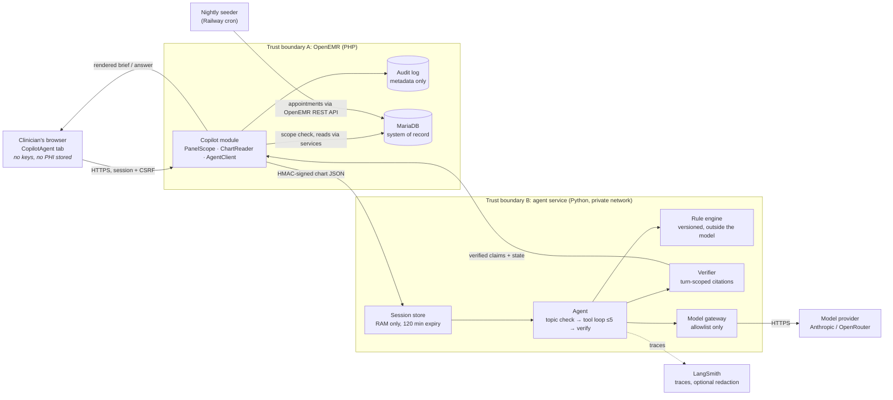

# Clinical Co-Pilot: Architecture

PHI data flow, trust boundaries, component responsibilities, authorization, the model gateway, storage, logging, verification, failure handling and the incident path, as required by the PRD ("Required Security Evidence", ARCHITECTURE.md). Every PHI-handling component states whether it **receives, stores, transmits or logs** PHI.

Companion documents: `AUDIT.md` (findings this design answers), `USER.md` (use cases and requirements), `KEY_METRICS.md` (what success is measured by), `SECURITY_TESTS.md` (runnable evidence), `ALERTS.md` (alert thresholds and on-call response), `copilot/evals/stage1/GROUNDING_RULES.md` (what "grounded" means), `copilot/README.md` (how to run it).

---

## Summary

**The problem.** A hospitalist needs to know what changed for each patient before rounds, and to ask follow-up questions at the bedside. The chart holds the answers but costs four to six minutes of navigation per patient. A language model can read faster than a clinician, and can also invent a potassium value that was never measured. The entire design follows from taking the second half of that sentence as seriously as the first.

**The shape.** Three tiers. The clinician's browser talks only to OpenEMR. A PHP module inside OpenEMR decides who you are, which patients are yours, and reads their charts through OpenEMR's own service layer. It forwards a signed request over a private network to a Python service that holds the agent and is the only component that talks to a model. The browser never holds a key and never reaches the model, so the disclosure path is a single auditable hop rather than a client-side integration.

**Key decision 1: retrieval is deterministic, the model only writes.** For the morning brief, the five questions are known in advance, so the service assembles the facts itself and makes one structured call. The model chooses no data. Only follow-up questions use a tool loop, and even there the tools are typed, narrow and patient-scoped. There is no model-generated SQL anywhere.

**Key decision 2: clinical judgements belong to code.** A versioned rule engine runs outside the model and owns every allergy conflict, interaction, dose threshold, lab range and medication status. The model cannot create, suppress or soften an outcome; it reports them verbatim. This is what makes the safety claim inspectable rather than probabilistic.

**Key decision 3: every displayed claim must cite a record fetched in that same turn.** A verifier deletes claims that cite nothing, cite another patient, state a number absent from their sources, or phrase a recommendation. Conversation memory deliberately carries no citation identifiers, which is what stops a model repeating an earlier answer as if it were fresh evidence.

**Key decision 4: no silent failure.** Every response is labelled complete, partial, unable to answer, or access denied, with a reason. Nothing is streamed: generation, verification and labelling all finish before the clinician sees a word, so a retracted claim is never shown and then withdrawn.

**Key decision 5: patient scope is enforced four times.** OpenEMR's permissions are role-based and let any authenticated user read every patient, which we measured rather than assumed. The module, the service, the session and each individual tool all re-check the assignment, because the boundary has no support underneath it.

**The main tradeoff.** Verification costs latency. A verified answer needs at least two model calls, so the interactive target of five seconds at the median is missed on the current free-tier model. Prefetching hides this for the brief, which is computed before the clinician opens the patient. Section 13 states this and the other tradeoffs plainly.

**Status.** Running locally and on a public Railway deployment, with synthetic data only, measured against the metric scorecard in `KEY_METRICS.md`.

---

## High-level architecture



One request: the browser asks OpenEMR, the module checks role and patient scope and reads the chart, then sends a signed request to the agent service. The service assembles facts, runs the rules, calls the model through the allowlisted gateway, deletes any claim the verifier rejects, labels the response state, and returns it through OpenEMR. The browser never reaches the service or the model. §1 shows the same picture with each component's PHI handling.

---

## 1. Components and trust boundaries

```
┌───────────────────────────── clinician's browser ─────────────────────────────┐
│  OpenEMR session cookie · CopilotAgent tab (index.php) · fetch() to api.php    │
│  receives: PHI (rendered brief)   stores: nothing   transmits: questions        │
└──────────────────────────────┬────────────────────────────────────────────────┘
                               │ HTTPS (Railway edge / local self-signed), same origin, CSRF header
┌──────────────────────────────▼───── OpenEMR (PHP, trust boundary A) ──────────┐
│  interface/modules/custom_modules/oe-module-copilot-agent                      │
│   PanelScope    role (Physicians + provider) and scope (providerID == user)     │
│   ChartReader   OpenEMR services -> compact chart JSON            receives PHI  │
│   AgentClient   HMAC-signed HTTP, correlation id                 transmits PHI  │
│   api.php       audit rows (EventAuditLogger)                logs metadata only │
│  MariaDB (patient_data, lists, prescriptions, procedure_*, log, api_log)  stores│
└──────────────────────────────┬────────────────────────────────────────────────┘
                               │ private network (railway.internal / host.docker.internal), HMAC-SHA256 signed
┌──────────────────────────────▼──── agent service (Python, trust boundary B) ──┐
│  copilot/copilot/service/app.py                                                │
│   session.py   in-memory charts + conversation, bound to user+patient, expiring │
│                briefs cached by (pid, chart fingerprint, model) so an unchanged │
│                chart is never briefed twice                                     │
│                receives PHI · stores PHI in RAM only · never on disk            │
│   agent.py     topic pre-check → tool loop (≤5) → verify → state               │
│   tools.py / constraints.py / verify.py  typed tools, rules, claim checks      │
│   llm.py       allowlisted provider only                        transmits PHI  │
│   telemetry.py JSON events (ids, states, counts, timings)      logs no PHI     │
└───────────┬────────────────────────────────────┬──────────────────────────────┘
            │ HTTPS                              │ HTTPS
┌───────────▼──────────── model provider ─────┐ ┌─▼──────────── LangSmith ───────────┐
│ allowlisted only: Anthropic direct, or      │ │ traces: prompts, tool I/O, outputs   │
│ OpenRouter (a further subprocessor, PHI9)   │ │ receives PHI unless TRACE_REDACT=1   │
│ receives PHI · retention per provider terms │ │ stores per workspace retention       │
└─────────────────────────────────────────────┘ └──────────────────────────────────────┘
```

Trust boundary A is OpenEMR's own session and ACL. Boundary B is the agent service, which trusts only requests signed with the shared secret and re-validates patient assignment itself. The browser is outside both and never holds a secret or a model key (PHI4).

## 2. Authorization flow (PRD FR2, FR15; USER.md REQ-SCOPE-1)

1. **Session.** `interface/globals.php` requires an authenticated OpenEMR session; anonymous requests never reach the module.
2. **Role.** `PanelScope::isHospitalist()` requires membership of the **Physicians** gacl group (the OpenEMR mapping of the PRD's hospitalist role) and `users.authorized = 1`. Administrators, front office, accounting, nurses and non-provider accounts are denied by default; the denial is audited (`copilot-role-denied`).
3. **CSRF.** Every POST carries a per-session token minted by `index.php`.
4. **Rounding list.** Today's appointments booked for the user (`openemr_postcalendar_events.pc_aid`) intersected with the user's assigned patients (`patient_data.providerID`). Both must hold.
5. **Per-read scope.** `ChartReader::read()` calls `PanelScope::assertInScope(pid)` first; `select` and `ask` call it again. Out-of-scope requests return `access_denied` with no patient content and no hint whether the patient exists (`copilot-scope-denied` audit row).
6. **Service-side re-check.** `SessionStore.open()` refuses any chart whose `provider_id` is not the session user. `select`/`ask` accept only pids in the session, and `ask` only the active one.
7. **Tool-level scope.** Every tool takes a `pid` and denies any value other than the active patient. The model cannot widen scope.

Why this exists: OpenEMR's ACLs are role-based and every user token reads every patient (AUDIT.md S3, measured). The module is the only patient-level boundary, and the service and tools repeat it (defence in depth).

## 3. PHI data flow, minimisation and storage

| Step | Data | Minimisation |
|---|---|---|
| ChartReader → service | Demographics (name, DOB, sex, pid, uuid), problems, medications, allergies, labs (last 3 years plus latest per test), encounters (last 5 years, always the latest 5), immunizations, vitals | Field-limited records; no notes, documents, insurance, contacts, SSN (REQ-MIN-1, PHI3) |
| service → model (brief) | A deterministic "facts pack": active disorders, recent labs with demo-range checks (max 25), compliance signals, medications with derived status, allergies, rule outcomes | Only what the five brief questions need |
| service → model (follow-up) | Tool results the model asked for, windowed and filtered by test name | Model must ask; nothing is pushed |
| service → browser | Verified claims, citations (type, label, date), rule outcomes, states | No raw records; evidence panel shows cited records only |

**Storage.** The service keeps charts and conversation in process memory, keyed by a hash of the OpenEMR session id and user id, and drops them after 120 idle minutes, on `close`, or on process restart. Nothing is written to disk. Conversation memory holds only the question and the verified answer text, without tool payloads and **without citation ids**, only for the active patient, and is cleared when the patient changes (FR5). Omitting the ids is deliberate: it is what makes "every claim traces to a lookup in this turn" enforceable (§7). OpenEMR itself stores PHI in MariaDB on the Railway volume (unencrypted by the application: AUDIT.md S11; synthetic data only).

**Transmission.** Browser↔OpenEMR over HTTPS. OpenEMR↔service over the private network with HMAC-SHA256 request signing and a 5-minute timestamp window; the service has no public domain on Railway. Service↔model and service↔LangSmith over HTTPS.

## 4. Technology choices

Pinned in `copilot/requirements.txt`. The guiding constraint was that a reviewer should be able to read the agent loop in one sitting, so the stack is deliberately thin.

| Concern | Choice | Why this one |
|---|---|---|
| Web framework | FastAPI 0.141.1 on Starlette 1.6.0, Uvicorn 0.53.0 | Typed request models validate at the boundary for free. Six signed endpoints and two health probes; no ORM, no session middleware, no database |
| Model clients | `langchain-anthropic` 1.7.2, `langchain-openai` 1.6.2 | Two providers behind one allowlist. OpenRouter is OpenAI-compatible, so the second client covers it and every model it fronts |
| Orchestration | LangChain core 1.6.3, for tool binding and structured output only | See below |
| Schemas and validation | Pydantic 2.13.5 | One validation library for four different jobs, so contracts are enforced identically wherever they cross a boundary |
| Observability | LangSmith 0.12.5 | Run trees correlate to the OpenEMR audit id, so a request is reconstructable end to end |
| Tests | pytest 9.1.1 | 68 unit and service tests, no network, model substituted by a scripted double |
| Seeder | `requests`, PyMySQL | A separate, much smaller image with no LangChain at all |

**No orchestration framework, deliberately.** The follow-up loop is a plain Python `for` over at most five rounds. LangGraph is installed as a transitive dependency of LangChain but is imported nowhere in this project. A graph framework would have bought durable state and branching we do not need, and would have hidden the one piece of control flow a clinical reviewer most needs to read. The cost of that choice is that retries, the iteration cap and the re-lookup pass are hand-written; the benefit is that they are visible in about twenty lines.

**The model is behind a four-line protocol** with two methods, `invoke_with_tools` and `structured`. The agent imports neither client. That is what lets the entire test suite run with no API key and no network, and it made swapping Anthropic for OpenRouter a configuration change rather than a refactor.

**Pydantic's four roles**, all of which matter to safety rather than convenience:

1. **The chart contract.** Produced by the PHP module, validated on arrival. Every record carries a `source_id` such as `lab:6001`, and that string is the unit of citation the whole verification strategy rests on.
2. **Model output contracts.** The model cannot return prose. It returns a `BriefDraft`, an `AnswerDraft` or a one-field `TopicCheck`, each claim carrying its `source_ids`. A schema violation becomes a bounded retry and then an honest failure state, not a parse attempt.
3. **Tool results.** Typed arguments mean a corrupted value from the model becomes a structured error the model can correct, rather than an exception that kills the turn.
4. **HTTP request models**, including a pattern constraint on the feedback category so free text cannot reach external analytics.

**Known drift:** `python-dotenv` is pinned at 1.1.1 while 1.2.3 is installed. Harmless, but the file is not currently reproducible to the letter.

## 5. Model gateway (PRD PHI1, PHI4, PHI8)

`copilot/copilot/llm.py` builds a model only when the provider, model name and endpoint are all on the allowlist (`COPILOT_ALLOWED_*`) and a key is present. Otherwise `ProviderNotApproved` is raised before any PHI leaves the service, `readyz` returns 503 and `session/open` returns 503.

- **Providers.** Anthropic directly, or OpenRouter (OpenAI-compatible; slugs carry a vendor prefix). With OpenRouter a second business associate sits between the service and the model vendor, so the BAA and subprocessor review (PHI9) must cover it. Free-tier slugs (`:free`) may be logged provider-side and are therefore demo-data only. Any allowlisted model must support tool calling and structured output.
- **Settings.** Temperature 0, output capped (`COPILOT_MAX_OUTPUT_TOKENS`), 40 s timeout. `COPILOT_REASONING` (default `off`) disables OpenRouter reasoning, because reasoning models otherwise spend the output budget on hidden thinking and lose the answer entirely. `COPILOT_JUDGE_MODEL` lets the evals grade with a different allowlisted model than the agent uses.
- **Failure classification.** `classify_model_error()` separates `rate_limit` (429), `provider_unavailable` (502/503/504, a gateway error body, a reply carrying no `choices`, connection or timeout) and `other`. The first two are retried up to three times honouring `Retry-After` or 8/16/32 s, then fail closed; the evals record them as **not applicable** rather than as agent failures, so an endpoint's quota never reads as an agent defect.
- **Traceability.** Every call is traced with the correlation id, patient reference (pid), kind (brief, answer or topic check), data categories and verification result (PHI8).

## 6. The answer path (FR6, FR12)

A follow-up question passes three stages before the clinician sees anything:

1. **Topic pre-check** (`COPILOT_TOPIC_CHECK`, on by default). One small structured call classifies the question **alone, with no conversation history**: is it about a patient's record or clinical care? A "no" returns the fixed scope statement with no tools, no claims and zero iterations. The judgement is deliberately made before the history is in play, because a model's off-topic judgement degrades once earlier answers are in context; measured on the free model, "what is the weather" after a lab answer re-emitted the labs. A failed check fails open and the question proceeds normally.
2. **Tool loop**, at most `COPILOT_MAX_ITERATIONS` (5) rounds. A malformed round is retried once. An invented tool name returns an error naming the tools that exist, and malformed arguments return an error describing what was wrong, so the model can correct itself instead of the turn dying on an exception (FR6: a tool always answers with a structured result).
3. **Verification**, as set out below. Nothing is streamed: generation, verification and state assignment all complete before the response is sent (PRD D010).

## 7. Verification strategy (FR7, FR8, FR16)

The strategy has one premise: **a model's assertion is a proposal, not a finding.** Nothing it writes reaches a clinician until a deterministic check has agreed. Four mechanisms, in the order they apply:

- The model must produce **structured drafts** (`BriefDraft`, `AnswerDraft`) in which every claim carries `source_ids`.
- `verify.py` removes any claim that cites nothing, cites a record outside the active patient's chart, **cites a record no tool returned in this turn**, states a number absent from its cited records (numbers the clinician typed in the question are allowed), or phrases a recommendation. Removed claims are counted and their reasons shown in the UI; the state becomes `partial`.
- **Turn-scoped citation** is what prevents a model restating an earlier answer to an unrelated question. Because conversation memory carries no citation ids (§3), a fact repeated without a fresh lookup cannot verify. When a whole turn is rejected for that reason, one re-lookup pass forces a tool call within the remaining iteration budget and the answer is re-verified.
- **Absence is citable.** An empty tool result carries `empty:<source>`, so "none recorded" cites the lookup that found nothing instead of needing an invented id.
- **No lookup means off-topic.** A turn ending with no tool call, no claims and no boundary means the model never consulted the chart, so the fixed scope statement is imposed whatever the model wrote.
- `constraints.py` runs five versioned rules (`demo-rules-2026.09.1`) outside the model: allergy conflict, dose threshold (acetaminophen, ibuprofen, metformin), interaction pairs (three), lab range against a demo reference table, medication status from end dates. Each returns pass / flag / unable_to_evaluate / engine_failure with the records it used. Outcomes are citable (`rule:ALLERGY-1`) and displayed verbatim; the model cannot alter them.

**How it is proven, not asserted.** Nine golden cases pin one correct answer each and run on every change; seven multi-turn scenarios grade the tool trace and memory; 68 unit tests cover the verifier, the rules and the scope boundary directly. The development history is the strongest evidence that the strategy works: the free-tier model invented tool names, corrupted arguments, fabricated citation identifiers and restated earlier answers, and in every instance the response degraded to a smaller honest answer rather than a wrong one. See `KEY_METRICS.md` for the measured figures.

## 8. Response states and failure handling (FR12, FR17, FR18, FR20)

| Condition | State | Where decided |
|---|---|---|
| All sources ok, all claims verified | complete | `agent.decide_state` |
| Question is not about the patient's record | complete, reason "not a question about this patient's record"; fixed scope statement, no tools | topic pre-check, or the no-lookup rule in `answer_followup` |
| Every claim was restated from memory without a lookup | one forced re-lookup pass; if it still fails, unable_to_answer naming the cause | `answer_followup` |
| Provider rate-limited or unavailable after three retries | unable_to_answer naming the category (evals score it **not applicable**) | `llm.classify_model_error` → `_draft_with_one_retry` |
| A source errored or timed out in ChartReader | partial (names the source) | ChartReader status → `decide_state` |
| Tool loop reached 5 rounds | partial ("tool-call limit reached") | `answer_followup` |
| A rule raised | partial ("constraint could not be evaluated: …") | `constraints.run_all` → `decide_state` |
| Some claims removed by the verifier | partial (count) | `decide_state` |
| All claims removed, or model invalid twice, or model unreachable | unable_to_answer | `_draft_with_one_retry`, `decide_state` |
| Follow-up exceeded the 60 s deadline | unable_to_answer ("response deadline … exceeded") | `SessionStore.ask` |
| Provider not approved / no key | session refused (503), prefetch marked failed | `app.session_open`, `SessionStore.prefetch` |
| Role, CSRF, scope or session failure | access_denied (403), no content | `api.php`, `SessionStore` |
| Audit row cannot be written | request fails (500), no clinical response | `api.php audit()` |
| Patient changed while an answer is in flight | answer discarded by the UI; memory of the previous patient cleared | `index.php`, `SessionStore.select` |

Each answer-affecting failure produces a user-visible `state_reason` and a structured event (`telemetry.emit`) with the correlation id, dependency, failure category and timing.

## 9. Logging, observability and correlation (FR14, NFR6, PHI7)

- **OpenEMR audit log** (`log` table): `copilot-open`, `copilot-select`, `copilot-ask`, `copilot-close`, `copilot-role-denied`, `copilot-scope-denied`, `copilot-agent-unavailable`. Comments hold the correlation id, state, iteration count, tool sequence, verifier counts and latency. They never hold the question text or record values. This answers AUDIT.md C1c (agent reads were not attributable).
- **Service events** (stdout, JSON lines): identifiers, states, categories, counts, timings. `telemetry.emit` refuses PHI-shaped field names. Besides the lifecycle events, the answer path emits `topic_check`, `followup_relookup`, `followup_no_lookup_treated_as_off_topic`, `tool_invalid_arguments`, and `model_tool_round_failed` / `model_draft_failed` carrying the failure category from §5. `COPILOT_DEBUG_MODEL_ERRORS=1` adds a short excerpt of an unclassified model error for local diagnosis only; it is off by default because exception text can echo prompt content.
- **LangSmith**: full traces for reconstruction, correlated by `metadata.correlation_id`. One request is one tree: `rounding_brief` or `followup_answer` is the only root, with the `topic_check` classification, each tool call and every model call nested beneath it. An off-topic refusal is traced like any other answer, so the response carries a `langsmith_run_id` a clinician's rating can attach to. On real PHI, either LangSmith is under a BAA or `COPILOT_TRACE_REDACT=true` hides inputs and outputs (AUDIT.md C4b).
- **Metrics**: `GET /metrics` (signed) exposes counters by response state, tool calls, claims kept and removed **with the cause of each removal**, auth rejections, clinician ratings by category, **retry counts** (rate limits, draft and tool-round retries, forced re-lookups) and p50/p95/p99 latencies for briefs and answers. No identifiers and no clinical content. Administrators read it through the **CopilotHealth** tab rather than by signing a request.
- **Health and readiness are separate**: `GET /health` reports only that the process is alive, so a dependency outage never causes an orchestrator to kill a working service; `GET /ready` probes the model provider endpoint, the LangSmith API and OpenEMR (`COPILOT_OPENEMR_URL`), checks the provider allowlist and the shared secret, and returns 503 naming whichever failed. `/healthz` and `/readyz` remain as aliases.

## 10. Retention and deletion (PHI6)

**The agent owns no database.** It defines no tables, runs no migrations and writes nothing to disk;
the module adds no schema to OpenEMR either, and its only direct write path is the nightly seeder,
which books appointments through the REST API so validation and audit logging run. What looks like a
schema is a typed wire contract (24 Pydantic models) validated at the boundary and discarded. That
keeps the EHR the single system of record — which is what makes “every claim cites a record fetched
this turn” verifiable — and leaves the co-pilot with nothing of its own to retain, encrypt or breach.
The cost is stated in COST_ANALYSIS.md: sessions die with the process, and a second replica starts
cold, which is the first thing that has to change at around 100 users.

| Store | Content | Retention |
|---|---|---|
| Service memory | charts, briefs, conversation | 120 min idle, `close`, or restart |
| OpenEMR `log` | audit metadata | OpenEMR policy (no purge configured; AUDIT.md C2) |
| OpenEMR `api_log` | not used by the co-pilot (it reads in-process, not via the REST API) | n/a |
| LangSmith | traces | workspace retention setting; redact for real PHI |
| Model provider | prompts | provider terms under the BAA |
| Browser | nothing persisted (no localStorage) | page lifetime |

## 11. Incident path (PHI10)

1. Disable the module row (`UPDATE modules SET mod_active=0 …`, see `deploy/railway/README.md`) or stop the agent service; the tab then degrades to "not configured" and no PHI moves.
2. Find every affected request by correlation id: OpenEMR `log` → service events → LangSmith run.
3. Rotate `COPILOT_SHARED_SECRET` (service variable and site config) and the model / LangSmith keys.
4. For PHI in an unapproved log or trace, delete the LangSmith project runs and rotate; record the finding in `AUDIT.md`.
5. Cross-patient output is impossible past the verifier by construction, but any report is treated as a scope defect: capture the correlation id, reproduce with the fixture charts, add an eval case.

## 12. Deployment shapes and the publish gate

- **Local**: OpenEMR in Docker (`docker/development-easy`), agent service on the host at `host.docker.internal:8600`, configuration in `sites/default/copilot-config.php` (on the sites volume, not a bind mount).
- **Railway**: four services in environment `v82`. `openemr-v82` runs an OpenEMR image built from this repository (8.2.0-dev, the code the dev stack runs; the stock 8.0.0 image until 2026-09-25) and `mysql-v82` holds its database; `copilot-agent-v82` built from `Dockerfile.copilot` with **no public domain**, reached at `copilot-agent-v82.railway.internal:8600`; and `copilot-seeder-v82`, a one-shot container built from `Dockerfile.seeder` that Railway's cron runs at 01:05 UTC to rebook the rounding list, which otherwise empties at midnight. Both Dockerfiles live at the repository root because `railway up` uploads the repo root as the build context. Secrets are Railway service variables; the module also reads the site config from the persistent volume, which avoids a redeploy.
- **The seeder's data path** differs from the laptop's: it reaches MariaDB directly over the private network (`OE_DB_VIA=mysql`), because `railway ssh` needs a CLI login a container does not have. Appointment writes still go through the REST API so validation and audit logging run (AUDIT.md C1b); only reads and the cleanup of its own prior bookings use SQL.
- **Publishing is gated.** `copilot/check_local.ps1` runs the unit tests and the stage 1 golden gate and writes `.local-checks-passed` with the commit and a hash of the uncommitted diff. `deploy/railway/deploy_agent.ps1` refuses unless that marker matches the tree it would upload, then requires the operator to type `DEPLOY`. Nothing else in the repository publishes to Railway.

## 13. Known tradeoffs

Each of these is a decision with a cost, not an oversight. They are stated as what was given up, for what.

| Decision | Bought | Cost | Why the trade is right here |
|---|---|---|---|
| **Verify before display, never stream** | No retracted claim is ever shown; no unverified text reaches a clinician | At least two model calls per answer. p95 of 19.8 s against a 10 s target on the free tier | A clinician who catches the tool in one fabrication stops trusting it. Latency is recoverable by prefetching and a faster model; trust is not |
| **Deterministic retrieval for the brief** | The model cannot choose what data to look at, so it cannot omit a source and hide it | The brief answers five fixed questions, not an open-ended one | The morning questions genuinely are fixed. Open-ended exploration is what follow-ups are for |
| **Rules outside the model** | Clinical flags are inspectable, versioned and reproducible | Coverage is five rules and a small demo table, far short of real decision support | A narrow rule that is always right beats a broad one that is sometimes invented. Marketing it as decision support would be the real defect |
| **Turn-scoped citations** | A model cannot pass off an earlier answer as fresh evidence | A legitimate repeat question costs a second lookup | Measured: without it, an off-topic question re-emitted the previous patient answers verbatim |
| **No orchestration framework** | The control flow is twenty readable lines | Retries, the iteration cap and the re-lookup pass are hand-written | The audience for this code includes people auditing safety, not only engineers |
| **In-memory sessions** | No PHI at rest in the agent; expiry is trivially correct | One process only; no horizontal scaling | A demo needs one process. Scaling would need a shared encrypted store with the same expiry rules (PHI5) |
| **Scope enforced in the application** | A clinician sees only their own panel | Four layers to keep in step, and none of it is enforced by OpenEMR | Not a choice: OpenEMR's permissions are role-based and every user token reads every patient (AUDIT.md S3, measured) |
| **Free-tier model** | Zero cost for development | Rate limits, provider outages, weaker instruction-following; NFR1 latency targets unmet | The guards are model-independent, so the cheap model is a harsher test of them. A paid model is one variable away |

**Scope limits that are not tradeoffs, just facts.** The dataset is ambulatory Synthea data with no current admission, overnight vitals or notes (USER.md §5), so the rounding list stands in as today's booked appointments and "recent labs" falls back to the most recent collection. The OAuth password grant remains enabled because the test suite needs it (AUDIT.md S1).
