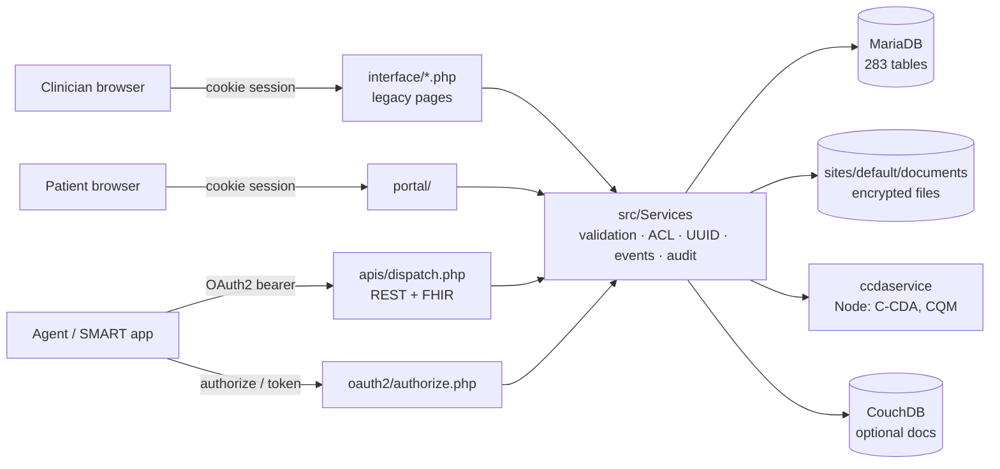

# OpenEMR Audit: Clinical Co-Pilot Readiness

## Summary of key findings

OpenEMR can work as the base for a read-only clinical co-pilot built on FHIR R4, but not as it stands. Five issues matter most.

**1. Data quality issues create risks for the agent.**

- **Medications:** All 306 prescriptions are marked active, but 243 have already ended. They lack start dates and routes, and almost all are duplicated in the database.
- **Problem list:** Most entries (70%) are non-clinical social notes or administrative reminders, with 858 duplicate records.
- **Vitals:** Vitals data is missing key metrics like blood pressure and weight for all 50 patients, and nearly all entries are over a year old.
- **Labs:** None of the 16,783 lab results include reference ranges or abnormal flags.

Reading this data directly will cause the agent to misreport past medications as active and administrative notes as medical diagnoses. A normalization layer is necessary before passing data to the LLM.

**2. High latency slows down conversational responses.**

- **Fixed overhead:** Every API call takes 1–2.7 seconds, even metadata requests that do not query the database.
- **Slow chart summaries:** Building a summary requires 8 sequential FHIR calls, taking about 11.4 seconds.
- **Slow lab fetching:** Fetching lab results takes up to 10.5 seconds due to PHP processing overhead rather than database queries.
- **Lack of pagination:** Searches return full datasets at once, resulting in large response payloads.

To improve performance, requests should run in parallel or prefetched, and data should be filtered, cached, and summarized before reaching the LLM.

**3. Authentication and security vulnerabilities pose significant risks.**

- Authentication bypass: OAuth password grant skips MFA unless requested by the client.
- Excessive permissions: 3-month refresh token lifespans and full patient access via user-level scopes.
- Missing access controls: Certain FHIR routes rely only on OAuth scopes without in-route ACL checks.
- Web security flaws: Permissive CORS policy and insecure session cookies lacking `HttpOnly` and `Secure` flags.
- Unsecure defaults: Default admin/database credentials must be removed before deployment.

**4. Logging creates excess PHI copies and misses key events.**

- **Unrestricted API logging:** Full response bodies (up to 475 KB per row) are stored in plain text without retention limits.
- **Audit noise:** 73% of logged events are SELECT queries, cluttering audit trails.
- **Missing audit events:** Bulk imports log zero patient-record insertions, and off-box ATNA forwarding is disabled.

Agent traffic will significantly multiply these logging risks.

**5. Regulatory obligations are unmet for real data.**

- **Missing BAAs:** Sending PHI to LLM providers, LangSmith, or hosting platforms requires Business Associate Agreements or prior de-identification.
- **No governance policies:** Missing data retention, automated purge, and breach detection mechanisms in code.
- **Incomplete encryption:** Stored documents are encrypted, but the core database is not encrypted at rest.

Synthetic data keeps the demo outside HIPAA. The production design still has to cover all of this.

**What works well:**

- **Architecture:** Unified service layer, UUID identifiers, and robust two-layer authorization (OAuth scopes + ACL).
- **Extensibility:** Clean extension points via events and custom modules.
- **Standardization:** 100% complete clinical coding (SNOMED, RxNorm, CVX, LOINC).
- **Data Integrity:** Zero duplicate patient records.

**Recommended order:**

1. A data normalization and summarization tool layer.
2. Parallel, filtered FHIR reads with caching.
3. Replace the password grant with SMART authorization-code + MFA.
4. Minimal API logging, with audit entries attributed to the agent.
5. A BAA-covered model endpoint before any real PHI.

---

## Contents

1. [Security audit](#1-security-audit)
2. [Performance audit](#2-performance-audit)
3. [Architecture audit](#3-architecture-audit)
4. [Data quality audit](#4-data-quality-audit)
5. [Compliance and regulatory audit](#5-compliance-and-regulatory-audit)
6. [Remediation roadmap](#6-remediation-roadmap)
7. [Method, environment and limitations](#7-method-environment-and-limitations)

Severity: **Critical** blocks agent correctness or real-data use · **High** fix before the agent is trusted · **Medium** fix before production · **Low** hygiene.

---

## 1. Security audit

### 1.1 Authentication and authorization

| ID | Severity       | Finding                                                                                                                                                                                                                                                                                                                                                                                                                                                                                                                                                                                                                                                                                                                                                                                                                                                                                                                                                                                                                                                                                                                                       | Evidence                                                                                                                                                                                               |
| -- | -------------- | --------------------------------------------------------------------------------------------------------------------------------------------------------------------------------------------------------------------------------------------------------------------------------------------------------------------------------------------------------------------------------------------------------------------------------------------------------------------------------------------------------------------------------------------------------------------------------------------------------------------------------------------------------------------------------------------------------------------------------------------------------------------------------------------------------------------------------------------------------------------------------------------------------------------------------------------------------------------------------------------------------------------------------------------------------------------------------------------------------------------------------------------- | ------------------------------------------------------------------------------------------------------------------------------------------------------------------------------------------------------ |
| S1 | **High** | **The OAuth password grant is enabled and bypasses MFA.** `oauth_password_grant=3` allows username/password token requests for both users and patients. MFA is checked only *if the client sends an `mfa_token`*; without one, valid credentials alone issue a token. An agent or attacker with a clinician's password gets API access without MFA.                                                                                                                                                                                                                                                                                                                                                                                                                                                                                                                                                                                                                                                                                                                                                                               | Live global`oauth_password_grant=3`; `src/Common/Auth/OpenIDConnect/Repositories/UserRepository.php:107-135` (comment: "this is only forced if mfa_token is provided") and `:137` (patient role) |
| S2 | **High** | **Long-lived tokens.** Access tokens last 1 h and refresh tokens **3 months**. Test runs left **15 unexpired refresh tokens** whose OAuth clients were already deleted, valid until 2026-12-15: the suite's cleanup removes `api_token` rows but not `api_refresh_token` rows.                                                                                                                                                                                                                                                                                                                                                                                                                                                                                                                                                                                                                                                                                                                                                                                                                                          | `src/RestControllers/AuthorizationController.php:110-111`; `api_refresh_token`: 15 rows, 15 orphaned; `usecases/conftest.py:79-80`                                                               |
| S3 | **High** | **User scopes cover every patient.** `user/*.read` scopes limit *resource types*, not *which patients*. Any user token, including one an agent holds, can read all 50 charts, subject only to the user's ACL role. There's no restriction by care team or assigned provider, and all 50 patients have no assigned provider (`providerID` empty), so that couldn't be enforced anyway. **Update 2026-09-15:** `doctor1` and `doctor2` now exist as providers on both the local stack and the Railway deployment, with the panel split 25/25 (see `scripts/README.md`), so provider-scoped access is testable. The scope limitation itself is unchanged: a user token still reads every patient. **Measured the same day:** a `doctor1` token returned all 50 patients from both FHIR `/Patient` and REST `/api/patient`, identical to `admin`, despite only 25 being assigned to that provider. OpenEMR's patient-filter events can hide patients in the UI but have no equivalent in `apis/` or `src/Services`, so scoping must be enforced in the agent's tool layer (`USER.md` REQ-SCOPE-1). | FHIR route closures in`apis/routes/_rest_routes_fhir_r4_us_core_3_1_0.inc.php` filter only when `isPatientRequest()`; `patient_data.providerID` empty for 50/50                                  |
| S4 | Medium         | **Inconsistent in-route ACL checks.** 71 FHIR routes but 64 `request_authorization_check` calls. `Location`, `Questionnaire`, `QuestionnaireResponse` (which holds patient answers) and `OperationDefinition` run with OAuth scope checks only; their controllers only special-case patient tokens. `Practitioner` has an open TODO about "open api access to admin information".                                                                                                                                                                                                                                                                                                                                                                                                                                                                                                                                                                                                                                                                                                                                           | Routes file lines 403-411, 650-676, 783-802;`src/RestControllers/FHIR/FhirQuestionnaireResponseRestController.php:110`                                                                               |
| S5 | Medium         | **Weak brute-force protection.** Lockout after 20 failed logins per user and 100 per IP. Idle session timeout is 2 h; password expiry 180 days; minimum length 9 (live).                                                                                                                                                                                                                                                                                                                                                                                                                                                                                                                                                                                                                                                                                                                                                                                                                                                                                                                                                                | `library/globals.inc.php:2113-2118, 2188-2221`; live globals                                                                                                                                         |
| S6 | Low            | **Open client registration, gated by admin enablement.** `POST /oauth2/default/registration` accepts anonymous requests, but new clients start disabled until an admin enables them. The test harness enables clients directly in SQL, which is acceptable for a test harness but shouldn't happen in production.                                                                                                                                                                                                                                                                                                                                                                                                                                                                                                                                                                                                                                                                                                                                                                                                                     | `src/Common/Auth/OpenIDConnect/Repositories/ClientRepository.php:238`; `usecases/conftest.py:74-75`                                                                                                |

### 1.2 Data exposure vectors

| ID  | Severity                        | Finding                                                                                                                                                                                                                                                                                                                                                                                                      | Evidence                                                                                                                                                                              |
| --- | ------------------------------- | ------------------------------------------------------------------------------------------------------------------------------------------------------------------------------------------------------------------------------------------------------------------------------------------------------------------------------------------------------------------------------------------------------------ | ------------------------------------------------------------------------------------------------------------------------------------------------------------------------------------- |
| S7  | **High**                  | **Full PHI response bodies are copied into `api_log`.** The default `api_log_option=2` (Full Logging) stores each response, and the request body column is filled with that response too. Of 54 rows, 14 contain patient records; the average response is 43.8 KB and the largest 475 KB, in plain text, with no expiry. Every agent read creates another copy of the chart.                       | `library/globals.inc.php:2893-2900` (default `2`); `src/RestControllers/Subscriber/ApiResponseLoggerListener.php:56-59, 83-84`; `api_log` queries                             |
| S8  | **High** (deploy blocker) | **The dev stack's credentials and services are unsafe off a laptop.** App `admin/pass`; MariaDB root `root/root` published on host port 8320; phpMyAdmin on 8310; CouchDB `admin/password`; Xdebug enabled; Selenium VNC on 7900. Compose publishes these ports on all interfaces by default. MariaDB supports TLS (`have_ssl=YES`) but doesn't require it (`require_secure_transport=OFF`). | `docker/development-easy/docker-compose.yml:7, 31-32, 63-72, 91-92, 128-129, 148`; live server variables. A hardened alternative exists: `deploy/digitalocean/docker-compose.yml` |
| S9  | Medium                          | **CORS echoes any origin.** `Access-Control-Allow-Origin` is set to whatever the request's `Origin` header says, and preflight responses allow credentials. Verified: `Origin: https://evil.example` came back unchanged from `/fhir/metadata`. Bearer tokens limit the damage, but any website can call the API from a browser that holds a token.                                            | `src/RestControllers/Subscriber/CORSListener.php:57, 67, 73` (with `@TODO: review security implications`); live response headers                                                  |
| S10 | Medium                          | **The main session cookie isn't `HttpOnly` or `Secure`.** This is deliberate (JavaScript manages sessions across multiple logins), but it means any XSS in the large legacy UI can steal a clinician session. Verified over HTTPS: `Set-Cookie: OpenEMR=…; path=/; SameSite=Strict`, with neither flag. HSTS, `X-Frame-Options: DENY` and `frame-ancestors 'none'` are present.             | `src/Common/Session/SessionUtil.php:9-14`; live `Set-Cookie` on `https://localhost:9300/interface/login/login.php`                                                              |
| S11 | Medium                          | **Encryption at rest is partial.** `drive_encryption=1` encrypts documents on disk and in CouchDB. Database tables (demographics, problems, medications, `api_log`, `log`) aren't encrypted by the application, so disk or volume encryption must cover them.                                                                                                                                    | `library/globals.inc.php:1035-1040`; live global                                                                                                                                    |
| S12 | Low                             | **The public health endpoint reveals component status**, e.g. `{"database":true,"oauth_keys":true,…}`, without authentication. It also wrongly reports `installed:false` (see CLAUDE.md).                                                                                                                                                                                                         | `GET /meta/health/readyz` live response                                                                                                                                             |

### 1.3 PHI handling specific to the agent

- **PHI in prompts and traces.** Each FHIR bundle the agent pulls becomes LLM input. If LangSmith tracing is on (the default stack), the full prompt and response, PHI included, are stored by a third party. See C4.
- **Oversized payloads.** Very large FHIR responses (S7, P2) tempt teams to send whole bundles to the model, which conflicts with **minimum necessary** (§164.502(b)). The agent's tools should request narrow resource types, categories and date ranges, and pass only the fields each question needs.
- **Synthetic identifiers.** Synthea left SSN, phone and email blank for all 50 patients, so direct identifiers aren't present to leak in this dataset. Don't treat that as a property of the system.
- **Legacy code.** CLAUDE.md documents `$GLOBALS`/`$_SESSION` as service locators and loose typing in legacy code. This audit didn't run a SAST scan or a penetration test on the legacy UI, and the XSS/SQL injection risk there should be treated as open (see §7).

---

## 2. Performance audit

### 2.1 Measured latency (agent call path)

The richest chart was used: 279 encounters, 282 conditions, 6,970 lab results. Each call ran 7 times with warm containers.

| Call                                                                                    |              Median |      Min–max |          Payload |       Entries |
| --------------------------------------------------------------------------------------- | ------------------: | ------------: | ---------------: | ------------: |
| `POST /oauth2/default/token` (password grant)                                         |            2,410 ms |  1,296–2,721 |             2 KB |            — |
| `GET /fhir/metadata` (no auth, no DB)                                                 |            2,702 ms |  2,079–3,450 |            36 KB |            — |
| `GET /fhir/Patient?family&given`                                                      |            1,221 ms |    869–1,560 |             3 KB |             1 |
| `GET /fhir/Patient/:id`                                                               |            1,202 ms |    916–1,702 |             2 KB |            — |
| `GET /api/patient/:puuid` (REST)                                                      |              961 ms |    804–1,582 |             3 KB |            — |
| `GET /fhir/Condition?patient`                                                         |            1,196 ms |    905–1,383 | **475 KB** | **282** |
| `GET /fhir/MedicationRequest?patient`                                                 |            1,684 ms |  1,464–2,411 |            17 KB |            20 |
| `GET /fhir/AllergyIntolerance?patient`                                                |            1,031 ms |    780–1,352 |           0.2 KB |             0 |
| `GET /fhir/Observation?patient&category=vital-signs`                                  |            1,266 ms |  1,189–1,430 |            22 KB |            15 |
| `GET /fhir/Encounter?patient`                                                         |            1,658 ms |  1,598–1,766 | **233 KB** | **279** |
| `GET /fhir/Immunization?patient`                                                      |            1,220 ms |  1,111–1,348 |            19 KB |            26 |
| `GET /fhir/Observation?patient&category=laboratory`                                   | **10,478 ms** | 9,767–11,371 | **8.5 MB** | 6,970 results |
| `GET /fhir/Patient` (all 50)                                                          |            1,291 ms |    956–1,560 |           118 KB |            50 |
| **One chart summary, 8 calls in sequence** (search patient through immunizations) |  **≈11.4 s** |               |                  |               |

### 2.2 Bottlenecks

| ID | Severity       | Finding                                                                                                                                                                                                                                                                                                                                                                                | Evidence                                                                                     |
| -- | -------------- | -------------------------------------------------------------------------------------------------------------------------------------------------------------------------------------------------------------------------------------------------------------------------------------------------------------------------------------------------------------------------------------- | -------------------------------------------------------------------------------------------- |
| P1 | **High** | **~1–2.7 s fixed cost per request.** `/fhir/metadata` doesn't touch patient data and still takes 2.7 s, so request startup dominates. Each API request loads `globals`, the site config and database connection, the kernel and the listener chain. Token issuance takes another 1.3–2.7 s.                                                                                | §2.1; pipeline in §3.2                                                                     |
| P2 | **High** | **No default pagination, and mapping is expensive.** Searches return every match in one bundle (282 Conditions / 475 KB; 279 Encounters / 233 KB). One patient's lab Observations take **10.5 s / 8.5 MB**, while the equivalent SQL over the same 6,970 rows takes **5 ms**. The cost is PHP turning rows into FHIR objects and serializing JSON, not the database. | §2.1;`SHOW PROFILES`: 0.005 s lab join, 0.0006 s problems, 0.0002 s encounters            |
| P3 | **High** | **Calls add up.** Answering "summarize this patient" takes ≥8 FHIR calls, ≈11.4 s in sequence, before any LLM time. Apache `prefork` handles concurrent requests, so the agent can fire them in parallel.                                                                                                                                                                    | §2.1;`httpd -V`: `Server MPM: prefork`                                                  |
| P4 | **High** | **Payloads overflow the LLM context.** The Condition bundle alone is 475 KB, roughly 100k+ tokens at about 4 characters per token. The lab bundle is about 20× larger. Raw bundles can't go to the model; the tools have to filter and summarize on the server side.                                                                                                            | §2.1 payload sizes                                                                          |
| P5 | Medium         | **Audit writes on every read.** `audit_events_query=1` logs every SQL SELECT, so 6,071 of 8,308 `log` rows (73%) are `security-administration-select`. Each agent read causes several audit INSERTs and row checksums (`log_comment_encrypt`). With full API logging (S7), large response bodies get written too.                                                        | `library/globals.inc.php:2832-2837`; `log` event counts                                  |
| P6 | Medium         | **The dev runtime exaggerates the absolute numbers.** OPcache is **off** (`opcache.enable=Off`), Xdebug is loaded (`xdebug.mode=debug`, trigger), and the source is bind-mounted from a Windows host. Re-measure on the production image (`deploy/digitalocean`) before setting latency targets. The relative patterns (P2–P4) won't change.                        | `php -i` inside the container; `docker/development-easy/docker-compose.yml:34-35, 71-72` |
| P7 | Low            | **Database left at defaults.** `innodb_buffer_pool_size` is 128 MB, which is enough for today's 84 MB schema but will bind as data grows. `slow_query_log=OFF`, so slow queries aren't recorded. `max_connections=151`.                                                                                                                                                    | Live server variables                                                                        |

### 2.3 How the data is structured (affects query design)

- **Size:** 283 tables, 84 MB. The largest are `lang_definitions` (27.5 MB, UI translations), `log` (10.7 MB after one day), `procedure_result` (7.2 MB) and `api_log` (6.5 MB from only 54 rows).
- **One table for several clinical lists:** problems, allergies and medications all live in `lists`, split by `type`. It has separate `pid` and `type` indexes but no composite `(pid, type)` index.
- **Medications in two places:** `prescriptions` and `lists.medication` (see D2).
- **Vitals:** `form_vitals` rows are linked to encounters through the generic `forms` table (`pid, encounter` index).
- **Labs:** `procedure_order` → `procedure_report` → `procedure_result`. `procedure_result` has no patient column, so every lab query needs a 3-table join. That's fast today (5 ms), but unfiltered lab reads return the patient's entire lifetime history.
- **Identifiers:** `uuid_registry` (31,722 rows) maps binary UUIDs to resources. Coverage is 100% for patients, encounters, lists, prescriptions, immunizations and vitals.

### 2.4 Constraints on agent response latency

1. **Budget:** ≈1–1.5 s per FHIR call plus 2.4 s per token. Reuse tokens for their full hour and never fetch a token per question.
2. **Run calls in parallel:** eight parallel calls should finish close to the slowest single call (≈1.7 s here) instead of ≈11.4 s.
3. **Always filter:** use `category`, `date`/`_lastUpdated` and `_count` on Observation, Encounter and Condition. Never pull unfiltered lab history.
4. **Cache per conversation:** chart data doesn't change mid-conversation for a read-only co-pilot.
5. **Fallback if FHIR is still too slow:** a custom module endpoint returning a pre-aggregated, normalized chart summary (see §3.4) avoids 8 separate FHIR round trips.

---

## 3. Architecture audit

### 3.1 Organization

OpenEMR contains two codebases that share one database:

- **Legacy procedural app:** `interface/` (1,828 files) and `library/` (617) render the clinician UI. Each page includes `interface/globals.php`, which loads the autoloader, `.env`, the error handler, the site and database connection, globals and the module kernel. Authentication uses a PHP cookie session.
- **Modern typed core:** `src/` (2,115 files, `OpenEMR\` PSR-4) serves the REST API, FHIR R4 (US Core 3.1.0), the patient portal API and OAuth2/SMART.
- **Shared service layer:** both converge on `src/Services` (132 service classes: 83 domain, 49 FHIR). It uses `QueryUtils` / `sqlStatement()` on Doctrine DBAL 4 and fires 80 event classes.

### 3.2 How the API layers interact

`apis/dispatch.php` wraps the request in `HttpRestRequest` and runs `ApiApplication`, a Symfony `HttpKernel` whose behavior lives entirely in subscribers, in this order:

1. ExceptionHandler
2. Telemetry
3. ApiResponseLogger (writes `api_log`, S7)
4. SessionCleanup
5. **SiteSetup** (site, database, globals)
6. CORS (S9)
7. **OAuth2Authorization** (bearer token)
8. **Authorization** (scopes, user or patient context)
9. **RoutesExtension** (match and dispatch)
10. ViewRenderer (JSON / FHIR JSON)

Each route is a closure: a **gacl** ACL check (usually), then the controller, then the service. For example, `GET /api/patient/:puuid` → `request_authorization_check($request, "patients", "demo")` → `PatientRestController::getOne()` → `PatientService`. Authorization is therefore **two layers**: OAuth scopes in the listener, plus the same role-based ACL the UI uses inside the route (with the gaps in S4).

- **Route counts:** 96 standard REST routes, 71 FHIR routes, 5 portal routes.
- **FHIR writes are limited:** Patient, Organization and Practitioner. Encounters, SOAP notes, vitals and appointments are written through the standard REST API.

### 3.3 Where data lives

| Store                                         | What                                                                             | Notes                                                       |
| --------------------------------------------- | -------------------------------------------------------------------------------- | ----------------------------------------------------------- |
| MariaDB`openemr`                            | All clinical, demographic, scheduling, billing, ACL (gacl), OAuth and audit data | 283 tables / 84 MB. Not encrypted at rest by the app (S11). |
| `sites/default/sqlconf.php`                 | Database credentials, install flag                                               | One directory per site (multisite)                          |
| `sites/default/documents/`                  | Uploaded documents, CCDAs, OAuth keys (`certificates/oa*.key`), EDI/ERA files  | Encrypted when`drive_encryption=1`                        |
| `log`, `log_comment_encrypt`, `api_log` | Audit trail and API request/response bodies                                      | Same database, same credentials (C1)                        |
| CouchDB                                       | Optional document store                                                          | Enabled in dev                                              |
| `ccdaservice` (Node)                        | C-CDA generation, CQM, schematron                                                | Called over a local socket                                  |
| PHP sessions                                  | Clinician UI sessions                                                            | Files, or Redis Sentinel if configured                      |

**Identifiers:** internal integer keys (`pid`, `encounter`) stay internal. APIs expose UUIDs from `UuidRegistry`. A few older nested REST routes (`/encounter/:eid/vital`, `soap_note`) still take integer IDs.

### 3.4 Integration points for new capabilities (least to most invasive)

| Option                                 | How                                                                                                                                   | Fit for the co-pilot                                                                                                                                                                                                                                              |
| -------------------------------------- | ------------------------------------------------------------------------------------------------------------------------------------- | ----------------------------------------------------------------------------------------------------------------------------------------------------------------------------------------------------------------------------------------------------------------- |
| **SMART on FHIR R4 over OAuth2** | Register a client, use authorization code + PKCE with narrow SMART scopes, and call`/apis/default/fhir/*`                           | **Recommended primary path.** Scopes, ACLs, API audit and tokens apply automatically. Use EHR launch to scope the token to the patient open in the UI (fixes S3 for the agent).                                                                             |
| **Standard REST API**            | `/apis/default/api/*`                                                                                                               | Needed for writes FHIR doesn't support here (encounters, SOAP notes, vitals, appointments). The same pipeline protects it.                                                                                                                                        |
| **Custom module**                | `interface/modules/custom_modules/<name>/openemr.bootstrap.php`, loaded by `ModulesApplication` with the EventDispatcher injected | For an in-UI co-pilot panel, reacting to events (`PatientUpdatedEvent`, …), or adding an aggregated summary endpoint and scopes through `RestApiCreateEvent` (fixes P3). It runs in-process with full access, so guardrails are the module's responsibility. |
| **Laminas modules**              | `interface/modules/zend_modules/module/`                                                                                            | Legacy MVC. Avoid for new work.                                                                                                                                                                                                                                   |
| **Direct SQL**                   | Read the database directly                                                                                                            | **Avoid.** It skips ACLs, UUIDs, validation, events and audit logging (C1). At most, use a read-only replica for analytics on de-identified data.                                                                                                           |

---

## 4. Data quality audit

All figures are from live SQL against the 50-patient Synthea dataset (counts as of 2026-09-15).

### 4.1 Findings and the agent failures they cause

| ID | Severity           | Finding                                                                                                                                                                                                                                                                                                                                            | Evidence                                                   | Agent failure                                                                                                                                                            | Mitigation                                                                                                                                                                  |
| -- | ------------------ | -------------------------------------------------------------------------------------------------------------------------------------------------------------------------------------------------------------------------------------------------------------------------------------------------------------------------------------------------- | ---------------------------------------------------------- | ------------------------------------------------------------------------------------------------------------------------------------------------------------------------ | --------------------------------------------------------------------------------------------------------------------------------------------------------------------------- |
| D1 | **Critical** | **Medication status is unreliable.** All 306 prescriptions have `active=1`, but **243 have an `end_date` in the past**. `start_date` is empty and `route` blank on all 306; 63 have no end date.                                                                                                                               | `prescriptions` queries                                  | "What is she taking?" lists medications stopped years ago as current.                                                                                                    | Derive status from`end_date`, not `active`. Always show dates. Say "status unverified" when dates are missing.                                                          |
| D2 | **High**     | **Medications are stored twice.** 299 of 306 prescriptions also appear in `lists` (`type='medication'`) with the same patient and title.                                                                                                                                                                                                 | Cross-table match                                          | Merging REST`lists` with FHIR `MedicationRequest` doubles the medication list.                                                                                       | Pick one source per tool (FHIR`MedicationRequest`) and de-duplicate by RxNorm code.                                                                                       |
| D3 | **High**     | **The problem list is mostly noise.** **1,220 of 1,750 (70%)** entries are SNOMED *findings*/*situations* (e.g. "Medication review due" ×401, "Stress" ×146, "Full-time employment" ×121). Only 519 are *disorders*. **858** rows repeat the same title for the same patient, and 417 have no end date (appear active). | `lists` queries; top-problem list                        | "What conditions does she have?" returns employment status and repeated screening flags as diagnoses.                                                                    | Filter or group by SNOMED semantic tag (`(disorder)` vs `(finding)`), de-duplicate by code keeping the latest, and separate social determinants into their own section. |
| D4 | **High**     | **Vitals are sparse and stale.** One vitals form per patient. **Blood pressure, weight and SpO₂ are empty for all 50**; height and pulse are present. 48 of 50 are more than a year old (range 2016-10-04 to 2026-08-25).                                                                                                             | `form_vitals` queries                                    | "What were her last vitals?" gives a years-old reading as current, or says "no BP" without saying why. There's no trend over time.                                       | Always give the date and age of the reading, name the missing measurements explicitly, and never present one reading as a trend.                                            |
| D5 | Medium             | **Labs have no reference ranges or abnormal flags.** `range` and `abnormal` are blank on **all 16,783** results. Codes and units are complete.                                                                                                                                                                                     | `procedure_result` queries                               | The agent can't say "abnormal" from the record, and may hallucinate a normal range.                                                                                      | Flag values only against a vetted reference-range table in the tool layer, with its source stated, or leave interpretation to the clinician.                                |
| D6 | Medium             | **Identity and demographic gaps.** **Every** first and last name has a numeric suffix (`Judie557 Abernathy524`), a Synthea artifact. SSN, phone and email are blank for all 50. **No patient has an assigned provider.** Race is blank for 1.                                                                                  | `patient_data` queries                                   | Name search on a natural name ("Judie Abernathy") finds nothing. Primary-care and care-team questions can't be answered, and access can't be scoped to a care team (S3). | Use fuzzy name matching with DOB confirmation. Strip the numeric suffixes when displaying demo data. Don't promise care-team features on this dataset.                      |
| D7 | Low                | **Allergy absence is ambiguous.** Only 7 of 50 patients have any allergy record (59 rows, all fully coded), and there's no "no known allergies" entry.                                                                                                                                                                                       | `lists` (`type='allergy'`)                             | The agent says "no allergies" when the truth is "no allergy information recorded".                                                                                       | Word empty results as "none recorded", never "none".                                                                                                                        |
| D8 | Low                | **History spans a lifetime, with uneven recency.** Encounters run from 1930-03-04 to 2026-09-14 (1–279 per patient, average 43). Only 9 patients were seen in the last 30 days; 4 not in over a year.                                                                                                                                       | `form_encounter` queries                                 | "Recent" answers mix in decades-old visits unless filtered. Unfiltered queries hit the payload limits in P2 and P4.                                                      | Apply default date windows in tools, with an explicit "full history" option.                                                                                                |
| D9 | Low                | **The dataset can't be reproduced.** `import-random-patients` creates different random patients each run, and the bulk import skipped audit logging (C1).                                                                                                                                                                                  | `docker/binary/utilities/devtoolsLibrary.source:666-708` | Eval cases tied to specific patients break after a re-import.                                                                                                            | Pin evaluations to the snapshot`openemr-synthea50-20260914-194243.sql.gz`, or pick test patients by chart shape (as `usecases/test_uc_clinical.py` does).               |

### 4.2 What is reliable

- **Duplicates:** none by name + DOB or `pubpid`. No missing or future DOBs.
- **UUIDs:** 100% present on patients, encounters, lists, prescriptions, immunizations and vitals.
- **Coding:** problems 100% SNOMED-CT, prescriptions 100% RxNorm, immunizations 100% CVX, and lab results 100% coded with units.
- **Encounters:** 100% have a reason, provider and facility, with no future dates.
- **Cross-API consistency:** FHIR and REST return the same UUID, name and birth date (`usecases` UC8, 18/18 passing).

---

## 5. Compliance and regulatory audit

> **Scope note:** the current dataset is synthetic (Synthea) and contains no PHI, so the demo itself isn't subject to HIPAA. The findings below describe what's missing for this system and agent to handle **real** PHI, which the production design must address. This is an engineering assessment, not legal advice.

### 5.1 Audit logging (§164.312(b) audit controls; §164.308(a)(1)(ii)(D) activity review)

| ID  | Severity       | Finding                                                                                                                                                                                                                                                                                                                                       | Evidence                                                                                                                                 |
| --- | -------------- | --------------------------------------------------------------------------------------------------------------------------------------------------------------------------------------------------------------------------------------------------------------------------------------------------------------------------------------------- | ---------------------------------------------------------------------------------------------------------------------------------------- |
| C1a | — (strength)  | Audit logging is**on by default**. It covers logins, patient-record access, orders, lab results, security administration and API calls. Each `log` row has a checksum row in `log_comment_encrypt` (8,308 / 8,308). Break-glass access can be force-logged.                                                                         | `library/globals.inc.php:2778-2851`; `src/Common/Logging/EventAuditLogger.php:69-80, 668-674`                                        |
| C1b | **High** | **Bulk imports bypass the audit trail.** The Synthea import created 50 patients and thousands of clinical rows, but `log` has **0** `patient-record-insert` events. Development-mode import writes directly and turns off audit logging. Any agent write path must go through the service layer, which audits; never raw SQL. | `contrib/util/ccda_import/import_ccda.php:12-16`; `log` event counts in the import window (2026-09-15 00:30–00:45 UTC)              |
| C1c | **High** | **Actions aren't attributed to the agent.** An agent using a clinician's token is logged as that clinician. `api_log` records `user_id`, `patient_id`, IP and URL, but not which OAuth client or which question triggered the access. An auditor couldn't tell the co-pilot's reads from a clinician's.                           | `api_log` columns: `id, log_id, user_id, patient_id, ip_address, method, request, request_url, request_body, response, created_time` |
| C1d | Medium         | **The audit trail can be altered.** Checksums sit in the same database, reachable with the same credentials, so anyone who can change `log` can also change `log_comment_encrypt`. ATNA forwarding to an external audit repository is **off**.                                                                                | `enable_atna_audit=0` (`library/globals.inc.php:2858-2863`)                                                                          |
| C1e | Medium         | **Too much noise to review.** 73% of audit rows are logged SELECT queries (`audit_events_query=1`), burying the events a reviewer needs.                                                                                                                                                                                              | `log` event counts                                                                                                                     |

### 5.2 Data retention (§164.316(b)(2)(i); state medical-records law)

| ID  | Severity       | Finding                                                                                                                                                                                                                                                                                                                                                                                                                                          | Evidence                                                                                                                    |
| --- | -------------- | ------------------------------------------------------------------------------------------------------------------------------------------------------------------------------------------------------------------------------------------------------------------------------------------------------------------------------------------------------------------------------------------------------------------------------------------------ | --------------------------------------------------------------------------------------------------------------------------- |
| C2a | **High** | **No retention or purge mechanism exists.** A search of `src/` found no retention, archival or purge logic for clinical data, `log` or `api_log`. The only related tooling is a hand-configured weekly cron that backs up the `log` table.                                                                                                                                                                                         | `grep` of `src/` (only FHIR model definitions and billing mention "retention"); `Documentation/README-Log-Backup.txt` |
| C2b | **High** | **Logs grow without limit and hold PHI.** `log` reached 10.7 MB and `api_log` 6.5 MB within about a day. `api_log` keeps full PHI response bodies forever (S7). HIPAA requires keeping documentation (policies, and in practice audit records) for **6 years**; how long medical records must be kept is set by **state law**. Neither period is configured, and nothing prevents indefinite duplication of PHI in logs. | Table sizes                                                                                                                 |

**Needed:** a written retention schedule (medical records per state law; audit logs ≥ 6 years), archival of `log` to write-once storage, and a much shorter retention period for `api_log` bodies. Better still, set `api_log_option=1` (minimal) so bodies aren't stored at all.

### 5.3 Breach notification (§§164.400–414)

| ID  | Severity       | Finding                                                                                                                                                                                                                                                                                                                             |
| --- | -------------- | ----------------------------------------------------------------------------------------------------------------------------------------------------------------------------------------------------------------------------------------------------------------------------------------------------------------------------------- |
| C3a | **High** | **No breach detection.** There's no alerting on unusual access (for example one token reading many charts), no export to a SIEM (ATNA off), and lockout thresholds are loose (S5). A breach would likely go unnoticed, and the notification clock starts at *discovery*, or when it reasonably should have been discovered. |
| C3b | **High** | **Breaches would be larger than necessary.** `api_log` duplicates PHI (S7), and the database isn't encrypted by the application (S11). PHI encrypted to HHS guidance counts as "secured", and breaches of secured PHI don't require notification. Unencrypted database volumes don't get that protection.                   |

**What the obligations would be:**

- **Individuals:** notified without unreasonable delay, and no later than **60 days** after discovery (§164.404).
- **500 or more residents of a state or jurisdiction:** notify prominent media outlets too (§164.406), and notify HHS at the same time as the individuals (§164.408).
- **Fewer than 500:** log the breach and report it to HHS within 60 days after the end of the calendar year (§164.408(c)).
- **Business associates** (including an LLM provider) must notify the covered entity no later than 60 days after discovery (§164.410); a BAA usually sets a shorter deadline.

**Needed:** an incident response plan, access-anomaly alerting on the API and audit logs, encryption at rest for database volumes and backups, and a record of every system holding PHI (database, `api_log`, backups, LLM provider, tracing).

### 5.4 BAA implications of sending PHI to an LLM (§164.502(e), §164.504(e); de-identification §164.514(b))

| ID  | Severity                           | Finding                                                                                                                                                                                                                                                                                                                                                                    |
| --- | ---------------------------------- | -------------------------------------------------------------------------------------------------------------------------------------------------------------------------------------------------------------------------------------------------------------------------------------------------------------------------------------------------------------------------- |
| C4a | **Critical** (for real data) | **The LLM provider is a business associate.** Sending PHI in prompts to a model provider means it creates, receives, maintains or transmits PHI for the covered entity. A **signed BAA is required before any real PHI is sent.** Standard API or consumer terms aren't a BAA.                                                                                 |
| C4b | **High**                     | **Every tool in the chain that sees PHI needs a BAA or no PHI.** In the default demo stack: LangSmith tracing stores full prompts and outputs, the hosting provider (DigitalOcean or Vultr) holds the database, and any vector store holds embedded chart text. Each one needs a BAA, a self-hosted/in-boundary deployment, or PHI redaction before data reaches it. |
| C4c | Medium                             | **Minimum necessary applies to prompts** (§164.502(b)). Sending whole bundles (P4) discloses far more PHI than a question needs. Tool outputs should carry only the fields required.                                                                                                                                                                                |

**Options for real data** (confirm current terms with each vendor):

1. Use a model endpoint covered by a BAA, such as Anthropic's API under a BAA for eligible customers, or Claude on AWS Bedrock, which runs under the AWS BAA as a HIPAA-eligible service. Configure no retention and no training on the data.
2. De-identify before the model sees data, using Safe Harbor (remove the 18 identifiers) or Expert Determination (§164.514(b)).
3. Keep tracing and evaluation data inside the BAA boundary: self-hosted LangSmith, or redaction before export.

The synthetic dataset lets the demo use standard endpoints. The architecture slides should show the BAA path.

### 5.5 Other HIPAA Security Rule controls relevant to the agent

| Control                                               | Status                                                                 | Evidence                        |
| ----------------------------------------------------- | ---------------------------------------------------------------------- | ------------------------------- |
| Unique user identification, §164.312(a)(2)(i)        | Met for humans;**not for the agent** (C1c)                       | Users table;`api_log` columns |
| Emergency access (break-glass), §164.312(a)(2)(ii)   | Supported                                                              | `gbl_force_log_breakglass`    |
| Automatic logoff, §164.312(a)(2)(iii)                | 2 h idle (UI), 1 h access token,**3-month refresh token**        | S2, S5                          |
| Encryption at rest, §164.312(a)(2)(iv) (addressable) | Partial: documents only                                                | S11                             |
| Person/entity authentication, §164.312(d)            | MFA exists but**password grant bypasses it**                     | S1                              |
| Transmission security, §164.312(e)(1)                | HTTPS + HSTS on 9300; database TLS optional; plain HTTP on 8300 in dev | S8; response headers            |

HHS proposed Security Rule changes in January 2025 that would make MFA and encryption at rest required rather than addressable. Check whether they've been finalized before production planning; S1 and S11 would then be compliance failures, not just best-practice gaps.

---

## 6. Remediation roadmap

| When                                  | Action                                                                                                                                                                                                        | Fixes            |
| ------------------------------------- | ------------------------------------------------------------------------------------------------------------------------------------------------------------------------------------------------------------- | ---------------- |
| **Before building agent tools** | Build a normalization layer in the agent's tools: medication status from`end_date`, de-duplication across `prescriptions`/`lists`, SNOMED semantic-tag filtering, dated vitals, "none recorded" wording | D1–D4, D7       |
|                                       | Parallel, filtered FHIR reads (`category`, date windows, `_count`), token reuse, per-conversation cache, and server-side summaries (never raw bundles to the LLM)                                         | P1–P4, C4c      |
|                                       | Pin eval cases to the snapshot or pick patients by chart shape                                                                                                                                                | D9               |
| **Before any deployment**       | Use the hardened production compose (`deploy/digitalocean/`): generated secrets, no phpMyAdmin/Xdebug/Selenium, no published database port, `require_secure_transport=ON`                                 | S8               |
|                                       | Set`api_log_option=1`; purge existing `api_log` bodies                                                                                                                                                    | S7, C2b          |
|                                       | Restrict CORS to known origins                                                                                                                                                                                | S9               |
|                                       | Re-measure latency on the production image with OPcache on; enable the slow query log                                                                                                                         | P6, P7           |
| **Before real PHI**             | Replace the password grant with SMART authorization-code + PKCE and EHR launch (patient-scoped tokens); require MFA; shorten refresh-token lifetime and revoke on logout                                      | S1–S3           |
|                                       | A dedicated OAuth client and user identity for the agent, with the originating question logged, for attribution                                                                                               | C1c              |
|                                       | Signed BAAs (model provider, tracing, hosting) or de-identification; minimum-necessary tool outputs                                                                                                           | C4a–C4c         |
|                                       | Encryption at rest for database volumes and backups; external write-once audit storage (ATNA or log shipping); access-anomaly alerting; incident response plan                                                | S11, C1d, C3a–b |
|                                       | Written retention schedule,`log` archival, `api_log` purge job                                                                                                                                            | C2a–b           |
|                                       | Tighten lockout thresholds; review ACL-free FHIR routes (S4); run SAST and a penetration test on the legacy UI                                                                                                | S4, S5, S10, §7 |

---

## 7. Method, environment and limitations

**Environment:**

- **Host:** Windows 11, Docker Desktop (22 CPUs, 16 GB).
- **Stack:** `docker/development-easy` (image `openemr/openemr:flex`, PHP 8.5, Apache prefork, OPcache off, Xdebug loaded) and MariaDB 11.8.8.
- **Code:** commit `7b887fb`.
- **Data:** 50 patients from `devtools import-random-patients 50`.

**Evidence sources:**

- **Code review:** API route tables, authorization, session, CORS and logging subscribers, globals defaults, and the import tooling.
- **Live SQL:** about 90 queries against the `openemr` database covering completeness, duplicates, staleness, indexes, sizes, logs, OAuth tables and live globals.
- **API timing:** a probe script registered a temporary OAuth client (removed afterwards), then timed each call 7 times.
- **HTTP headers:** captured with `curl`.

**Limitations:**

- **Performance:** measured on the dev configuration, so absolute latency will be lower on the production image. The relative findings (pagination, payload size, number of calls) still hold.
- **Security testing:** no automated SAST or dependency scan and no penetration test, so XSS, CSRF and SQL injection in the legacy `interface/` and `library/` code weren't exhaustively assessed.
- **Data coverage:** only Synthea synthetic data was examined. Real clinic data typically has different problems (free-text entries, local codes, merged charts), so repeat §4 on any real dataset.
- **Regulatory references:** HIPAA provisions are cited for engineering planning. Vendor BAA availability and state retention periods change, so confirm them with counsel and the vendors.
